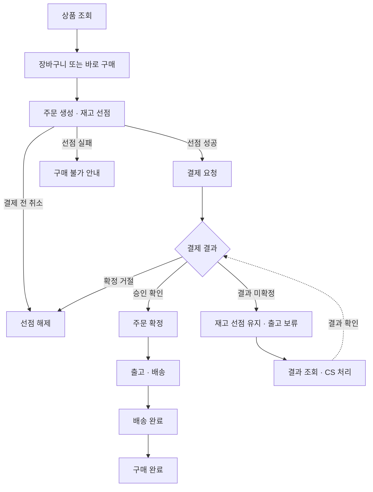
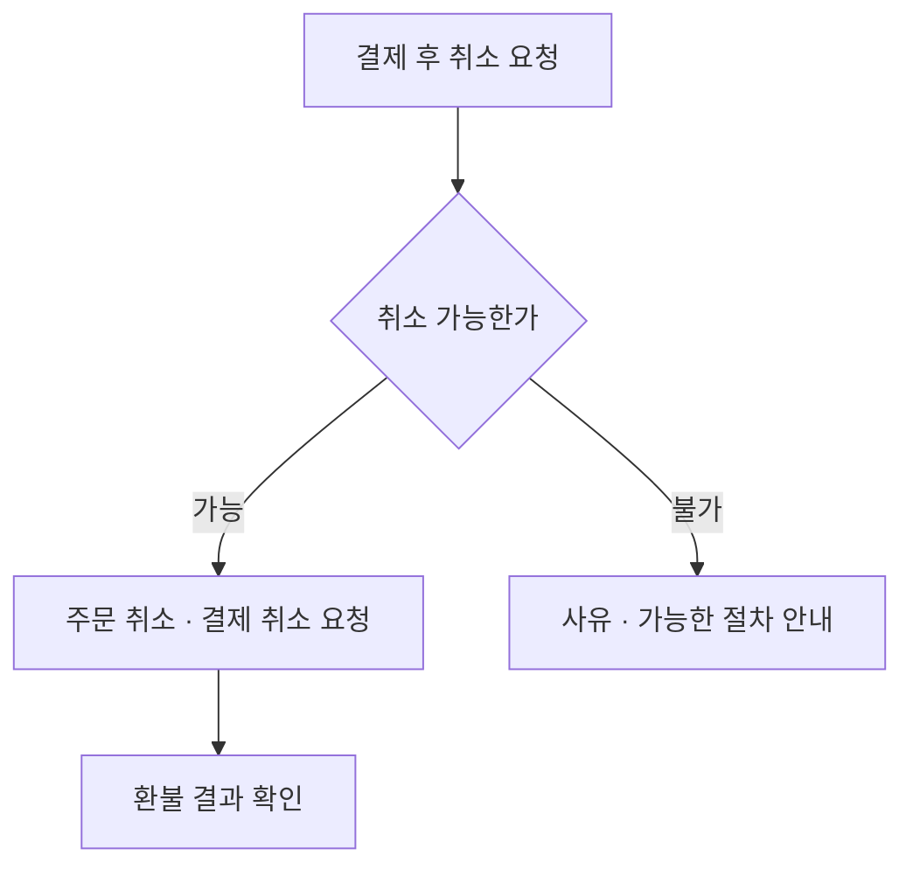
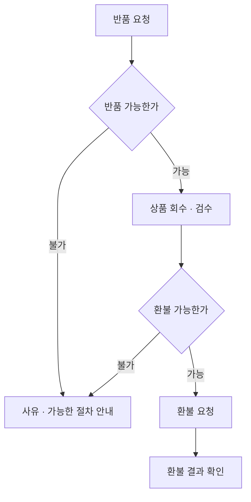
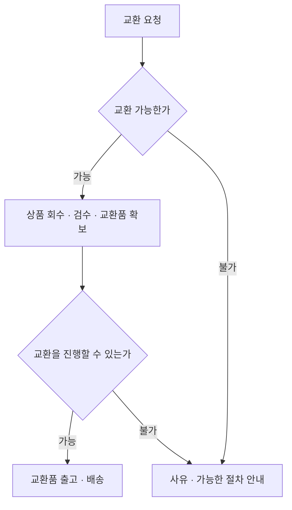

# kdk-commerce

상품 조회부터 주문·결제·배송, 취소·반품·환불까지 구현하는 B2C 커머스 프로젝트.

## 시작한 배경

유통업 백엔드 개발자로 일하며 외주업체가 개발·운영하는 자사몰의 변경 요청을 다뤘다. 기능 추가와 수정이 업체의 일정과 우선순위에 따라 지연되면서 필요한 시점에 반영하기 어려웠다. 향후 자사몰 자체 개발을 준비하기 위해, 커머스의 기본 거래 흐름을 직접 설계하고 구현하는 개인 프로젝트를 시작했다.

## 기술 스택

| 구분 | 기술 | 상태 |
| --- | --- | --- |
| 언어·프레임워크 | Kotlin · Spring Boot | 확정 |
| DB·데이터 접근 | MySQL(InnoDB) · Spring Data JPA | 제안 |
| 빌드 | Gradle Kotlin DSL | 제안 |
| 테스트 | JUnit · Testcontainers | 제안 |
| 실행·배포 | Docker Compose | 제안 |

처음에는 기능별로 코드를 나눈 모듈러 모놀리스로 만든다. 부하 한계와 장애를 확인하고 개선안을 비교한 뒤, 일부 기능을 MSA로 분리한다.

## 패키지 구조 — 초안

```text
io.github.owencity.commerce
├── member       # 회원·인증
├── catalog      # 상품·가격
├── cart         # 장바구니
├── order        # 주문·취소·구매 완료
├── inventory    # 입고·재고·선점
├── payment      # 결제·결제 취소·환불
├── shipping     # 출고·배송
├── returns      # 반품·교환
└── support      # 고객 문의·CS·AI 답변 초안
```

아래는 `order` 내부 구조의 예시다. 다른 기능도 필요한 책임에 따라 나눈다.

```text
order
├── api             # 요청 수신·응답
├── application     # 주문 처리 순서·트랜잭션
├── domain          # 주문 상태·금액·취소 조건
└── infrastructure  # DB 저장·외부 API 연동
```

모듈 간 통신에는 애플리케이션 이벤트를 사용한다. 다른 기능의 DB 테이블이나 내부 구현을 직접 사용하지 않는 구조를 제안한다.

회원·장바구니·교환은 기본 기능으로 포함하는 안이다.

## 문서 목차

| 순서 | 문서 | 상태 |
| --- | --- | --- |
| 1 | [요구사항](docs/02-requirements.md) | 검토 중 |
| 2 | 업무 흐름·상태 설계 | 작성 예정 |
| 3 | DB 설계 | 작성 예정 |
| 4 | 시스템 구조·API 설계 | 작성 예정 |
| 5 | 테스트·장애·부하 시험 | 작성 예정 |
| 6 | 설계 결정 기록(ADR) | 작성 예정 |

## 거래 흐름 예시

### 주문·결제·배송



### 취소·환불



### 반품·환불



### 교환 — 제안



부분 취소·부분 반품도 포함한다. 취소 가능 시점, 회수·검수 순서, 할인·배송비·환불액 계산과 교환 조건은 요구사항에서 정한다.
