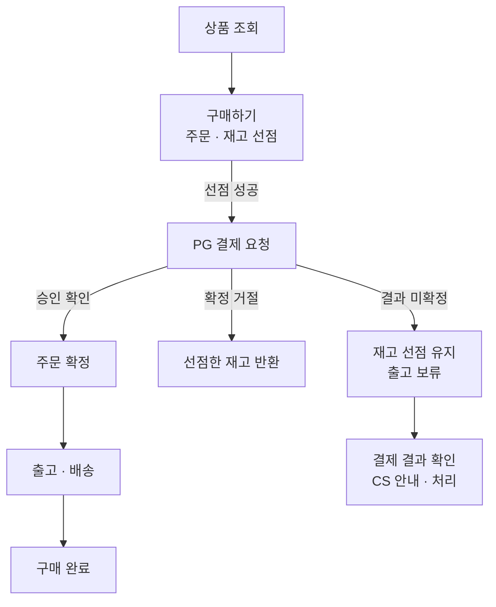

# kdk-commerce

**상품 조회부터 주문·결제·배송, 취소·반품·환불까지 설계하고 구현하는 커머스 프로젝트.**

마지막 재고를 두 사람이 동시에 구매하면 누구의 주문을 받아야 할까? 결제는 됐는데 쇼핑몰이 응답을 받지 못했다면 상품을 보내도 될까? 이런 상황에서 주문·재고·결제를 어떻게 처리할지 정하고, 코드와 시험으로 확인한다.

기능뿐 아니라 설계하는 과정도 기록한다. 어떤 문제를 발견했는지, 어떤 방법을 비교했는지, 왜 그 방법을 선택했고 무엇을 포기했는지 문서에서 코드와 시험 결과까지 따라갈 수 있게 남긴다.

> **진행 상태 · 2026-11-11** — 요구사항을 검토하고 있다. 이 README와 요구사항은 검수 전 초안이다. 커머스 애플리케이션 구현과 DB 상세설계는 아직 시작하지 않았다. 장애·부하 시험도 실행 전이다. Markdown 문서를 읽는 로컬 웹 화면은 실행할 수 있다.

## 다룰 거래 흐름

아래는 구현할 흐름의 개요다. 결제 성공 뒤 고객의 취소 요청이 없는 경우를 기준으로 그렸으며, 실제 상태 이름이나 처리 순서를 확정한 설계도는 아니다.

PG는 결제대행사, CS는 고객 상담을 뜻한다. 재고 선점은 구매 중인 고객에게 수량을 잠시 확보하는 것이다. 통신 오류는 결제 실패와 구분한다. 결과를 모르면 선점과 출고 보류를 유지하고, 서버의 결과 확인과 CS 처리를 이어간다.

취소·반품·환불도 전체 범위에 포함한다. 취소와 출고가 동시에 요청되는 경우, 주문 일부를 반품하는 경우의 할인액·배송비·환불액은 별도로 설계한다. 각 기능의 구현 단계와 세부 조건은 요구사항 검토에서 정한다.

## 문서 목차

문서는 기능 목록과 최종 설계뿐 아니라 검토한 질문, 대안과 선택 이유를 함께 담는다. 아래 순서는 읽는 순서이며, 설계 중 앞 문서의 조건이 바뀌면 함께 수정한다. 작성 예정인 문서는 아직 파일이 없다.

| 순서 | 문서 | 담을 내용과 고민 | 현재 상태 |
| --- | --- | --- | --- |
| 1 | [요구사항](docs/02-requirements.md) | 누가 어떤 기능을 사용하는가. 결제 실패와 결과 미확정에서 재고를 어떻게 처리할까. 무엇을 확인해야 기능이 완성됐다고 볼까. | 초안 검토 중. 재고·결제에 관해 합의한 정책과 미결정 질문 포함 |
| 2 | 업무 흐름·상태 설계 | 주문·결제·재고·배송 상태가 언제 바뀌는가. 정상 처리와 취소·실패·복구를 흐름도와 시퀀스 다이어그램으로 설명한다. | 작성 예정. `03-domain.md`에서 검토 |
| 3 | DB 설계 | 어떤 기록을 남겨야 주문을 복구할 수 있을까. 테이블 관계, 중복을 막는 제약조건, 함께 저장해야 할 데이터와 인덱스를 ERD·예시로 설명한다. | 작성 예정. 상세설계와 함께 검토하며 문서 분리 여부는 작성 시 정함 |
| 4 | 시스템 구조·API 설계 | 기능을 어디까지 나누고 어떻게 호출할까. 외부 API가 느리거나 응답하지 않을 때 어디까지 영향을 받는지 구성도와 요청·응답 예시로 설명한다. | 작성 예정. `04-design.md`에서 검토 |
| 5 | 테스트·장애·부하 시험 | 마지막 재고의 동시 구매, 결제 응답 유실, 서버 재시작을 어떻게 재현할까. 실행 조건·기대값·관측값과 한계를 남긴다. | 커머스 시험 계획·결과 문서 작성 예정 |
| 6 | 설계 결정 기록(ADR) | 중요한 선택에서 비교한 대안, 채택 이유와 바꿔야 할 조건을 남긴다. 관련 요구사항·설계·PR·시험 결과로 연결한다. | 작성 예정 |

배경은 [문제정의서](docs/01-problem.md), 협업·작성·검증 기준은 [프로젝트 지침](AGENTS.MD)에 있다. 문제정의서는 초기 내재화 배경을 다룬 문서로, 현재 목적과 예산의 반영을 기다리고 있다. 그 문서의 OpenAI API 월 1만원은 철회된 예산이다. 현재 범위는 요구사항과 프로젝트 지침을 기준으로 검토한다.

## 지금까지 검토한 질문

### 결제 결과를 모를 때 재고를 돌려줘도 될까

구매자가 결제를 시도했지만 쇼핑몰이 응답을 받지 못한 상황을 검토했다. 바로 재고를 반환하면 다른 고객이 살 수 있지만, 처음 결제가 실제로 성공했다면 상품을 보내지 못할 수 있다.

현재 합의는 **확정된 결제 거절이면 반환하고, 결과를 모르면 선점을 유지하는 것**이다. 대신 결과 확인이 길어지는 동안 다른 고객에게 판매하지 못한다. 서버가 결과를 확인하는 간격과 장기 미해결 건의 처리 절차는 후속 설계에서 정한다. [요구사항 Q1](docs/02-requirements.md)을 기준으로 구체화한다.

### ERP의 재고가 늦게 반영되면 판매해도 될까

쇼핑몰 재고가 0이면 입고 수량이 실제로 반영될 때까지 품절을 유지하기로 했다. 다만 다른 판매처와 창고 재고를 공유한다면, 그 판매처가 마지막 수량을 먼저 판매한 경우도 고려해야 한다.

자사몰 몫을 따로 배정하는 방법과 공통 시스템에서 수량을 확보하는 방법을 비교하고 있다. 어떤 조건으로 검증할지는 아직 정하지 않았다. [요구사항 Q2](docs/02-requirements.md)에 조건과 한계를 정리했다.

### DB와 서비스는 어떤 근거로 나눌까

DB 설계를 시작할 때는 주문·결제·재고가 함께 지켜야 할 조건부터 확인할 계획이다. 예를 들어 결제는 성공했는데 주문을 저장하지 못한 상황에서 어떤 기록으로 복구할 수 있는지 살펴본다. 테이블이나 서비스를 먼저 나눈 뒤 그 구조에 업무를 맞추지 않도록 검토한다.

서비스 분리 전에는 모놀리스의 부하 한계와 실패를 측정한다. 코드·쿼리·인덱스 등의 개선과 서비스 분리를 비교하고, 일부 기능을 MSA로 나눈 뒤 같은 조건에서 다시 측정할 계획이다. 분리하면 더 빨라진다는 결론은 미리 내리지 않는다.

## 개발 방향

백엔드는 **Kotlin + Spring Boot**, 처음 구조는 **모듈러 모놀리스**로 정했다. 하나의 애플리케이션 안에서 담당 기능을 나누는 방식이다. 구체적인 버전과 DB 제품은 상세설계·호환성 검토를 거쳐 정한다.

직접 만든 상품·주문 데이터와 모의 PG·ERP·배송 API를 사용한다. 실제 회사 코드나 고객 데이터는 사용하지 않는다. 거래 흐름은 API와 어드민·CS 화면으로 확인한다. 전체 쇼핑몰 프론트 UI는 현재 구현 범위에 포함하지 않는다.

AI는 상담원이 검토할 CS 답변 초안으로 다룬다. 주문·배송의 현재 상태는 API로 조회하고, 직접 작성한 정책 문서와 사람이 승인한 합성 상담 답변은 RAG로 검색한다. 검색·답변 평가, 사람의 승인, 호출 비용과 실패 처리를 검증할 계획이며 유료 API 예산은 미정이다. AWS 배포 실습은 필요한 시점에 무료 혜택을 우선하고 월 최대 3만원 안에서 검토한다.

## 진행 방법

사용자가 테크 리드로 요구사항·설계·로직과 결과를 검수한다. AI 에이전트는 문서·설계·코드·테스트를 작성하고, 선택 이유와 검증 결과를 설명한다. 의견이 다르면 근거와 대안을 놓고 검토한다.

요구사항 검토 → 업무 흐름·DB·시스템 설계 → 작은 단위의 구현·시험 → 검수 순서로 진행한다. 구현 중 놓친 조건을 발견하면 요구사항과 설계도 함께 고친다. 작업한 날의 질문·결정·실제 변경·남은 일을 관련 문서와 커밋·PR에 기록한다. 초안 게시와 내용 승인은 구분한다.

## 문서를 브라우저로 읽기

GitHub에서는 위 목차로 Markdown 원본을 읽을 수 있다. 로컬에서는 Node.js와 npm을 설치한 뒤 `npm ci`, `npm run docs:open`을 실행한다. Windows에서는 `open-docs.cmd`를 더블클릭해도 된다. 서버가 실행 중이면 원본 문서를 저장할 때 본문·목차·다이어그램이 갱신된다.

## 남은 질문

- 첫 구현에 취소·반품·환불을 어디까지 포함할까.
- 자사몰 판매용 재고를 따로 배정할까, 다른 판매처와 공통으로 확보할까.
- 주문 확정·취소·출고가 겹치면 어떤 조건으로 처리할까.
- 장애 후 복구에 필요한 기록과 허용할 복구 시간을 어떻게 검증할까.

## 이 결정이 가르치는 CS 개념

마지막 재고를 동시에 구매하는 문제는 동시성, 결제 응답 유실은 네트워크의 부분 실패와 연결된다. 서버가 재시작된 뒤 기록이 남는지는 내구성, 같은 요청을 다시 받아도 중복 주문·결제를 만들지 않는지는 멱등성으로 검증한다. 기술 용어는 해당 상황의 설계와 시험에서 구체적으로 설명한다.
