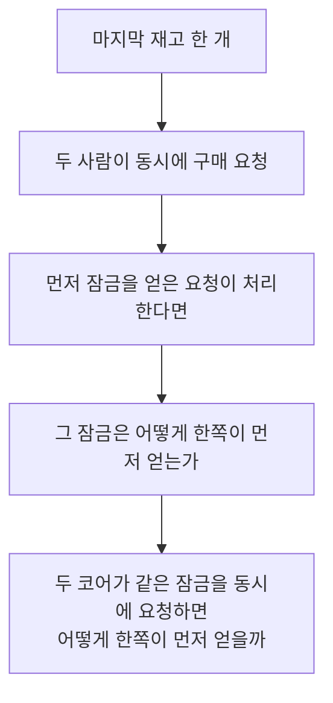
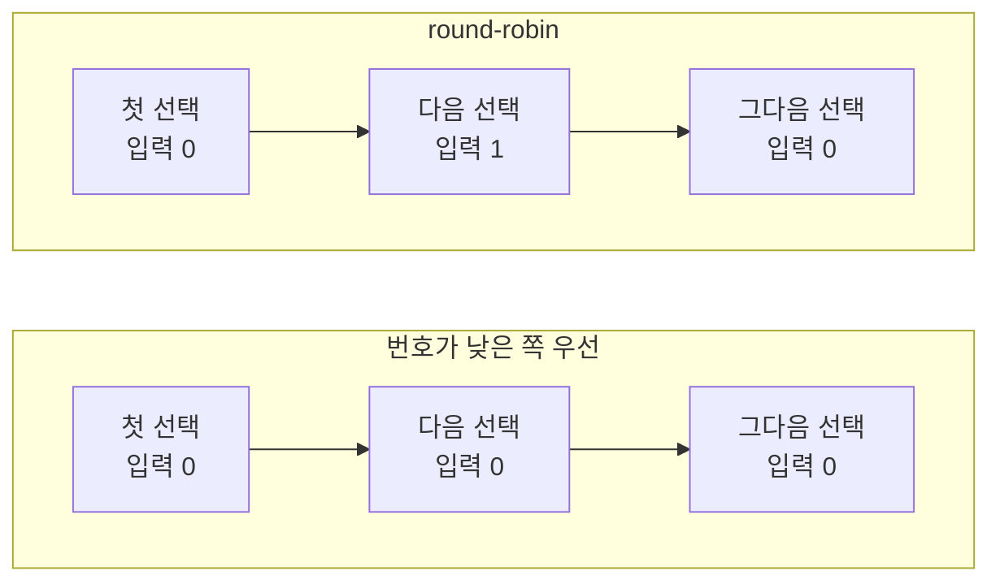
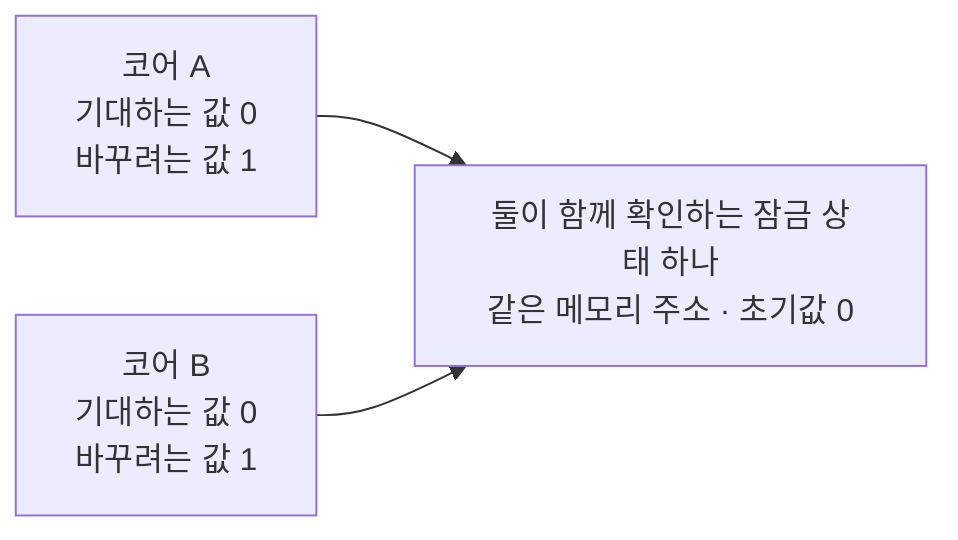
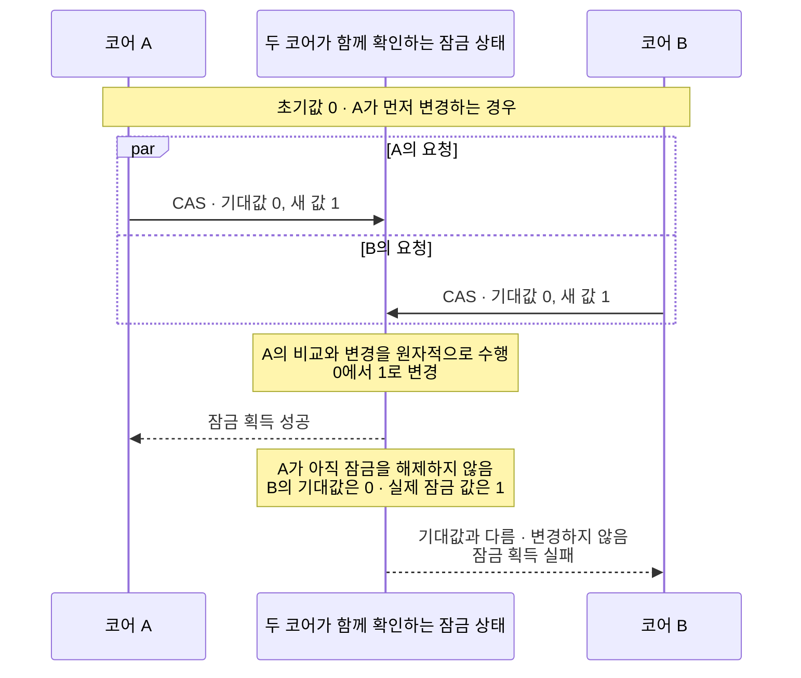

# 마지막 재고 한 개에서 CPU의 처리 순서까지

검수 전 초안 · 작성 2026-11-14 · 보완 2026-11-16 · 관련 요구사항: [F04 재고 선점](../02-requirements.md)

## 주문 요청에서 시작한 질문

주문 요청 단계를 검토하면서 마지막 재고 한 개를 두 사람이 동시에 구매하는 상황을 생각했다. 이 프로젝트에서는 고객이 구매하기에 진입할 때 재고를 선점한다. 선점은 결제를 진행하는 고객에게 수량을 잠시 확보해 두는 것이다.

마지막 한 개를 두 사람에게 모두 줄 수는 없다. 한 사람만 선점에 성공해야 한다는 조건은 분명했다. 그런데 여기서 질문이 하나 더 생겼다.

> 두 사람이 정말 똑같은 시각에 구매 버튼을 눌렀다면, 시스템은 누구에게 먼저 재고를 줄까?

재고가 음수가 되지 않게 막는 방법만 궁금했던 것은 아니다. 두 요청이 정확히 동시에 처리하려고 할 때, 한쪽을 먼저 선택할 수 있는 이유를 알고 싶었다.

질문은 재고 정책에서 시작했지만, 점차 DB 아래에서 순서가 만들어지는 과정으로 내려갔다.

## 잠금을 먼저 얻은 요청이라는 설명으로는 부족했다

처음에는 이전에 배운 내용을 이렇게 이해하고 있었다.

- CPU는 매우 짧은 시간 차이와 PID로 요청을 구분하므로 실제로 동시에 처리되는 일은 거의 없을 것이다.
- CPU와 DB가 시간을 표현하는 정밀도가 달라서, DB에서는 두 요청을 같은 시각으로 취급하고 중복 처리하는 것이 아닐까?

확인해 보니 서로 다른 개념을 섞어서 이해하고 있었다. PID는 프로세스를 식별하는 번호다. Linux에서는 같은 프로세스의 여러 스레드가 PID를 공유한다. PID가 있다는 이유로 요청이 하나씩 실행되는 것은 아니다. 여러 코어는 서로 다른 스레드를 동시에 실행할 수 있다. [Linux getpid(2)](https://man7.org/linux/man-pages/man2/getpid.2.html), [Oracle Processes and Threads](https://docs.oracle.com/javase/tutorial/essential/concurrency/procthread.html)

두 요청의 실행이 겹치는 문제와, 로그나 DB에 기록하는 시각의 정밀도는 구분해야 했다. 더 정밀한 시계를 사용한다고 재고 확인과 변경이 하나의 작업으로 묶이지는 않는다.

그다음에는 “DB에서 먼저 잠금을 얻은 요청이 처리한다”는 설명을 검토했다. 하지만 이것도 내가 궁금했던 지점까지 답하지는 못했다.

> 둘이 동시에 잠금을 요청했다면, 그중 하나가 먼저 잠금을 얻는 과정은 무엇인가?

클릭 후 네트워크를 거치는 동안 도착 순서가 달라질 수 있다는 설명으로 끝내지 않고, 같은 자원에 대한 요청이 동시에 겹친 경우까지 내려가 보기로 했다.

## 동시에 들어와도 하나를 선택하는 하드웨어

공유 자원에 여러 요청이 몰리면, 하드웨어는 그 접근을 조정한다. 이를 **중재(arbitration)**라고 한다. 두 요청의 시각 차이를 찾아내는 대신, 회로에 정해진 우선순위나 기억해 둔 차례를 이용해서 하나를 고를 수 있다.

구체적인 예로 AMD의 **FPGA용 AXI Interconnect** 문서를 확인했다. 이 부품에는 요청이 들어오는 연결부마다 번호와 우선순위 설정이 있다. 연결부 번호를 문서에서는 슬롯 번호라고 부른다. 슬롯 번호는 고객 번호나 PID가 아니다. **먼저 도착한 요청에 0번을 붙이는 것도 아니다.** 요청이 어느 연결부로 들어왔는지를 구분하는 번호다.

두 연결부를 입력 0과 입력 1이라고 하면, 다음처럼 동작할 수 있다. [AMD Transaction Arbitration](https://docs.amd.com/r/en-US/pg059-axi-interconnect/Transaction-Arbitration)

| 조건 | 요청을 선택하는 방식 |
| --- | --- |
| 두 요청의 우선순위가 모두 1로 같음 | 번호가 낮은 입력 0을 먼저 선택한다. |
| 두 요청의 우선순위가 모두 0임 | round-robin으로 차례를 돌아가며 선택한다. |

그림은 매번 두 입력 모두 처리 가능한 요청을 내고, 선택한 요청이 수락된 뒤 다음 선택을 하는 경우다. round-robin의 첫 차례는 입력 0으로 가정했다. 실제 부품은 처리 한도 때문에 일부 요청을 선택 대상에서 제외할 수도 있다.

여기서 번갈아 주는 것은 **입력 연결부의 요청을 처리할 기회**다. 이번 재고를 고객 A에게 주고 다음 재고는 반드시 고객 B에게 주는 쇼핑몰 정책을 뜻하지 않는다.

여기서 이해한 것은 **완전히 동시에 요청해도, 이미 정해진 선택 방식과 내부 상태가 있으면 하나를 고를 수 있다**는 점이다. 이 FPGA 부품의 규칙을 Intel Core·AMD Ryzen·Apple M 시리즈 CPU의 실제 선택 규칙으로 적용할 수는 없다.

## 잠금 값 0과 1은 무엇을 뜻하는가

이 설명을 읽다가 다시 의문이 생겼다. A와 B가 각각 0을 갖고 시작하는 것일까? 아니면 A에 0번, B에 1번을 붙여 순서를 정하는 것일까?

앞에서는 입력 번호와 우선순위에 0과 1을 썼고, 이번에는 잠금 상태에도 같은 숫자를 썼다. 숫자는 같지만 뜻은 다르다.

| 구분 | 숫자가 나타내는 것 |
| --- | --- |
| 입력 0·입력 1 | 하드웨어의 요청 연결부 번호. 먼저 도착한 순서가 아니다. |
| 우선순위 0·우선순위 1 | 앞의 FPGA 부품에서 요청의 우선순위를 정하는 설정값. |
| 잠금 값 0·잠금 값 1 | 아래 예시에서 잠금을 아무도 보유하지 않는지, 누군가 보유하는지 나타내는 상태. |

### 두 코어가 확인하는 잠금 상태는 하나다

같은 데이터를 동시에 바꾸지 않도록, 프로그램이 함께 사용할 잠금을 하나 준비했다고 가정한다. **잠금 값은 그 잠금의 현재 상태를 메모리에 기록한 값**이다. 이 예시에서는 다음처럼 정한다.

| 잠금 값 | 뜻 |
| --- | --- |
| 0 | 아무도 잠금을 보유하지 않음 |
| 1 | 누군가 잠금을 보유하고 있음 |

0과 1은 이 간단한 예시에서 정한 표현이다. 모든 잠금 구현이 두 값만 사용한다는 뜻은 아니다. 또한 **1이라는 값만 보고 보유자가 A인지 B인지 알 수는 없다.** 아래 그림의 보유자는 진행 과정을 설명하기 위해 따로 적은 정보다.

A와 B가 각자 가진 것은 **기대하는 값 0**이다. 비교할 대상은 같은 메모리 주소에 있는 잠금 상태 하나다. A에게 0번, B에게 1번을 부여한 것이 아니다. 두 코어 모두 “아무도 잠금을 갖고 있지 않다면 내가 얻겠다”는 뜻으로 0에서 1로 변경을 시도한다.

### 둘 다 처음에 0을 봤다면 어떻게 되는가

별도의 일반 읽기를 먼저 했다면 두 코어가 모두 0을 읽었을 수 있다. 그렇더라도 나중에 그 값만 믿고 무조건 1을 쓰면 안 된다. **실제로 잠금을 얻으려는 순간의 비교와 변경이 함께 이루어져야 한다.**

이를 하나의 원자적 연산으로 수행하는 것이 CAS(Compare-and-Swap)다. 원자적이라는 말은 같은 값에 대한 다른 변경이 비교와 변경 사이에 끼어들지 못한다는 뜻이다. CAS는 대상의 값이 기대하는 값과 같을 때만 새 값을 저장한다. 보통의 읽기와 쓰기를 각각 실행하는 것과는 다르다. [Microsoft InterlockedCompareExchange](https://learn.microsoft.com/en-us/windows/win32/api/winnt/nf-winnt-interlockedcompareexchange)

두 코어가 동시에 시도했더라도, A가 0을 1로 바꾼 뒤 잠금을 유지하고 있다면 B의 CAS는 1을 확인한다. **B의 기대값이 0이라고 해서, 공통 잠금의 실제 값도 계속 0인 것은 아니다.** B가 이전에 0을 읽었더라도 그때의 값만 근거로 잠금 획득에 성공할 수는 없다.

Intel 공식 자료는 캐시된 메모리에 대한 잠긴 연산에서 캐시 일관성 메커니즘으로 원자적 실행을 보장하는 경우를 설명한다. 항상 메모리 버스 전체를 잠그는 것은 아니다. [Intel 캐시 일관성과 원자적 실행](https://www.intel.com/content/www/us/en/support/articles/000099741/processors/intel-xeon-processors.html)

CAS가 번호순이나 round-robin을 선택하는 것은 아니다. 하드웨어 중재는 경합한 접근의 처리 기회를 조정하고, CAS는 비교와 조건부 변경을 원자적으로 수행한다. 이 그림은 그 차이를 이해하기 위한 예시이며, 특정 CPU에서 A가 먼저 선택된 정확한 이유를 밝혀낸 결과는 아니다.

### 잠금을 얻는 것과 재고를 선점하는 것은 다르다

잠금은 재고를 확인하고 바꾸는 처리에 다른 요청이 동시에 끼어들지 못하게 하는 데 사용한다. 재고 선점은 고객에게 판매할 수량을 확보하는 업무 처리다. 아래는 두 값의 차이를 보여주는 단순한 예시이며, 실제 DB 구현을 정한 것은 아니다.

| 진행 상황 | 공통 잠금 값 | 판매 가능 재고 |
| --- | --- | --- |
| 시작 | 0 · 아무도 보유하지 않음 | 1개 |
| A가 잠금을 얻음 | 1 · A가 보유 | 1개 |
| A가 재고 1개를 선점하고 기록함 | 1 · A가 보유 | 0개 |
| A가 재고 처리를 마치고 잠금을 해제함 | 0 · 아무도 보유하지 않음 | 0개 |
| B가 다시 시도해 잠금을 얻은 경우 | 1 · B가 보유 | 0개 |
| B가 품절을 확인하고 잠금을 해제함 | 0 · 아무도 보유하지 않음 | 0개 |

**잠금 값이 다시 0이 되었다고 판매 가능 재고가 1개로 돌아오는 것은 아니다.** B는 잠금을 얻어 재고를 확인할 수 있어도, 이미 A가 확보한 마지막 수량을 다시 선점할 수는 없다. A의 선점은 기존에 정한 해제 조건을 충족해야 반환된다. 결제 결과를 모르는 동안에는 시간이 지났다는 이유만으로 반환하지 않는다.

표에서 B가 다시 잠금을 얻는 것은 가능한 진행 예시다. CAS 실패가 자동 재시도나 B의 다음 차례를 보장하지는 않는다. 실제로 실패한 요청을 대기시킬지, 언제 다시 시도할지는 사용하는 잠금 구현과 애플리케이션에서 다룬다.

## 다시 재고 선점으로 돌아와 구분한 것

하드웨어까지 내려가면서 처음에 하나로 생각했던 질문을 나눌 수 있었다.

| 질문 | 이번에 정리한 내용 |
| --- | --- |
| 정확히 동시에 요청하면 순서를 만들 수 없는가? | 만들 수 있다. 시각의 미세한 차이 없이도 중재 방식과 내부 상태로 한쪽을 선택할 수 있다. |
| 그러면 클릭을 먼저 한 고객이 반드시 이기는가? | 위 동작만으로는 보장하지 않는다. 선착순을 약속한다면 접수 기준과 구현을 정해야 한다. 다만 초과 판매를 막는 데 선착순 대기열이나 추첨이 필수인 것은 아니다. |
| 그 선택 규칙을 쇼핑몰 코드에서 전부 구현해야 하는가? | DB와 OS·하드웨어에 동시 접근을 조정하는 기능이 있다. 애플리케이션은 필요한 보장을 제공하는 기능을 올바르게 사용해야 한다. |
| CPU가 원자적 연산을 제공하면 재고 문제도 해결되는가? | 재고 확인·변경·선점 기록을 어떻게 묶을지, 중간 실패를 어떻게 처리할지는 여전히 애플리케이션과 DB 설계의 문제다. |

예를 들어 MySQL InnoDB의 `SELECT ... FOR UPDATE`는 읽은 레코드에 잠금을 걸고, 충돌하는 잠금 요청을 대기시킬 수 있다. 잠금은 트랜잭션이 커밋되거나 롤백될 때 해제된다. 이것은 DB가 제공하는 동작이며, 위 그림의 잠금 값 하나가 그대로 DB의 행 잠금이라는 뜻은 아니다. 일반적인 일관 읽기까지 모두 막히는 것도 아니다. [MySQL 8.4 Locking Reads](https://dev.mysql.com/doc/refman/8.4/en/innodb-locking-reads.html)

또한 잠금을 먼저 얻었다고 재고 선점이 최종 성공한 것은 아니다. 그 트랜잭션이 롤백되면 변경도 취소된다. 고객에게 선점 성공을 언제 알릴지는 저장 결과와 함께 설계해야 한다.

## 커피챗에서 다시 살펴본 주문과 예매의 차이

주말 커피챗에서 이 문제를 놓고 이야기를 나눴다. 주문에서는 이런 일이 거의 없고, 예매에서는 생길 수 있다는 의견을 들었다. 이를 계기로 마지막 재고를 두고 경쟁하는 상황이 주문과 예매에서 어떻게 다른지 살펴봤다.

| 비교한 상황 | 수량을 기준으로 받아줄 수 있는 요청 |
| --- | --- |
| 같은 상품이 100개 있고, 두 사람이 각각 1개를 구매 | 두 사람 모두 구매할 수 있다. |
| 같은 상품의 마지막 1개를 두 사람이 구매 | 한 사람만 확보할 수 있다. |
| 같은 공연·회차의 A열 12번 좌석을 두 사람이 예매 | 다른 좌석이 남아 있어도, 그 좌석은 한 사람만 확보할 수 있다. |

지정 좌석은 좌석마다 수량이 한 개인 셈이다. 같은 좌석에 요청이 몰리면 누구의 요청을 받아줄지가 바로 문제가 된다. 상품 주문도 한정 판매나 마지막 재고에서는 남은 수량보다 많은 요청이 들어올 수 있다. 재고가 충분하더라도 각 주문의 수량 변경이 빠짐없이 반영돼야 한다는 조건은 같다.

공개된 사례도 확인했다. 배민 선물하기는 상품권 재고를 설계하면서 **초과 판매 방지와 재고 증감의 동시성 처리**를 요구사항으로 다뤘다. 좌석 예매가 아닌 구매 시스템에서도 검토하는 문제라는 근거다. [우아한형제들 기술블로그, 2021-01-19](https://techblog.woowahan.com/2709/)

다만 이 사례만으로 주문과 예매 중 어느 쪽에서 더 자주 발생하는지는 알 수 없다. 커피챗에서 나온 의견도 모든 주문 서비스에 적용되는 사실로 단정하지 않는다.

기존에 정리한 원리와 재고 선점 검증 계획은 유지한다. **이 프로젝트에서는 마지막 한 개에 요청이 겹쳐도 한 사람만 선점하는지 확인한다.** CPU까지 내려가 확인한 내용은 동시 요청의 처리 원리를 이해한 기록이며, 실제 DB 잠금·갱신 방식은 후속 설계에서 비교한다.

## 다음에 확인할 재고 선점 설계

기존에 정한 조건은 유지한다. 구매하기 진입 시 재고를 선점하고, 마지막 한 개를 두 사람이 모두 확보하게 해서는 안 된다. 이번 검토로 DB 잠금 방식이나 고객의 우선순위 정책을 새로 확정하지는 않았다. MySQL도 현재 기술 스택의 제안 단계다.

다음 질문은 **재고 확인·수량 변경·선점 기록을 어디까지 하나의 트랜잭션으로 묶을 것인가**다. 그 범위를 정한 뒤에는 아래 상황을 시험할 계획이다.

- 재고 한 개에 두 요청을 겹쳐 실행했을 때, 성공한 선점 수량이 한 개를 넘지 않는지 확인한다.
- 남은 재고가 음수가 되지 않고, 재고 수량과 선점 기록이 서로 맞는지 확인한다.
- 한 요청이 변경 도중 실패했을 때, 롤백 후 다른 요청이 남은 재고를 선점할 수 있는지 확인한다.

고객의 우선순위 정책이 없는 시험에서 특정 고객 A가 항상 이기는 것을 기대값으로 삼지는 않는다. 이번에 확인한 것은 순서가 생기는 원리다. 재고 선점 코드와 DB 동시성 시험, CPU 내부 동작의 실측은 아직 하지 않았다.

## 확인한 자료

기존 기술 자료는 2026-11-14에 확인했다. AMD의 중재 규칙과 Microsoft의 CAS 동작은 2026-11-16에 다시 확인했고, 같은 날 배민 선물하기의 재고 설계 사례를 추가로 확인했다.

| 자료 | 발행·갱신일 | 이 글에서 확인한 범위 |
| --- | --- | --- |
| [Linux getpid(2)](https://man7.org/linux/man-pages/man2/getpid.2.html) | 문서 표기 2026-02-08 | PID는 프로세스 식별자이며 같은 프로세스의 스레드가 공유한다. |
| [Oracle Processes and Threads](https://docs.oracle.com/javase/tutorial/essential/concurrency/procthread.html) | 미표기 · JDK 8 튜토리얼 | 프로세스·스레드, 여러 실행 코어와 동시 실행의 기본 개념. 현재 JDK 설정의 근거로 사용하지 않는다. |
| [AMD Transaction Arbitration](https://docs.amd.com/r/en-US/pg059-axi-interconnect/Transaction-Arbitration) | 2025-12-19 · PG059 2.1 | FPGA용 AXI Interconnect의 우선순위·슬롯 번호·round-robin. Ryzen CPU의 내부 규칙이 아니다. |
| [Microsoft InterlockedCompareExchange](https://learn.microsoft.com/en-us/windows/win32/api/winnt/nf-winnt-interlockedcompareexchange) | 2022-05-24 | 비교·교환의 원자성. Windows API의 동작이며 프로젝트의 구현 선택은 아니다. |
| [Intel 캐시 일관성과 원자적 실행](https://www.intel.com/content/www/us/en/support/articles/000099741/processors/intel-xeon-processors.html) | 최종 검토 2026-07-08 | 문서의 Xeon 환경에서 캐시 일관성과 원자적 실행. 모든 CPU의 내부 우선순위를 설명하는 자료는 아니다. |
| [MySQL 8.4 Locking Reads](https://dev.mysql.com/doc/refman/8.4/en/innodb-locking-reads.html) | 미표기 | InnoDB 잠금 읽기의 동작과 트랜잭션 종료 시 잠금 해제. 내부 구현이 단일 CAS라는 근거는 아니다. |
| [선물하기 시스템의 상품 재고는 어떻게 관리되어질까?](https://techblog.woowahan.com/2709/) | 2021-01-19 | 상품권 구매에서 초과 판매 방지와 재고 증감의 동시성을 다룬 사례. 주문·예매의 발생 빈도를 비교한 자료는 아니다. |
